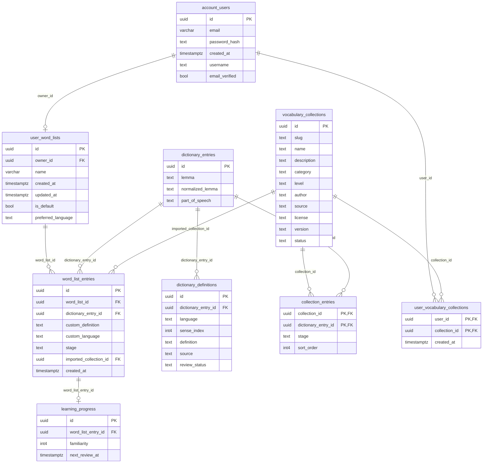
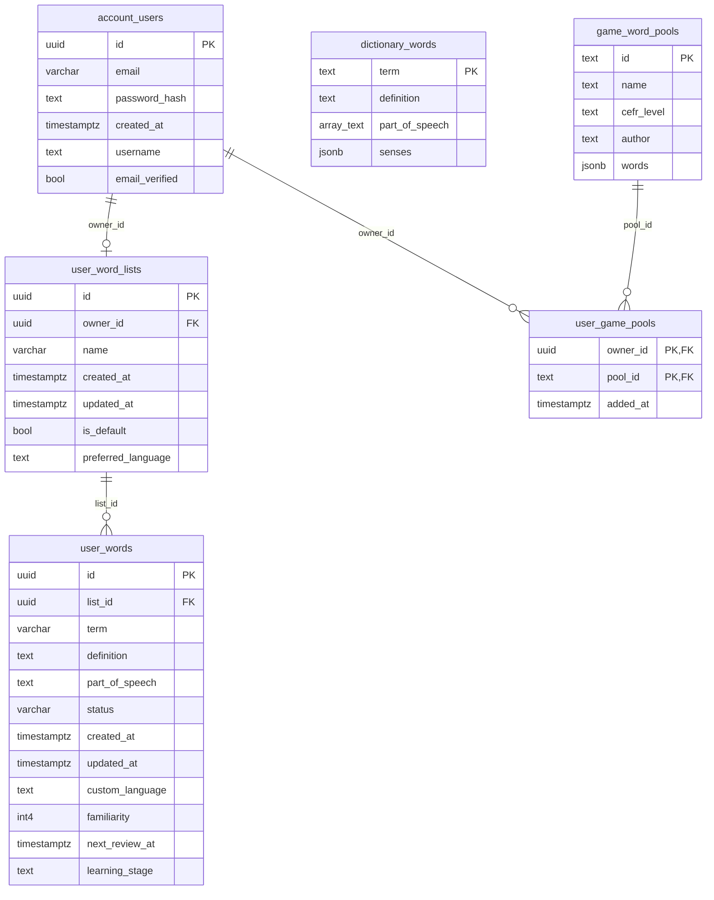
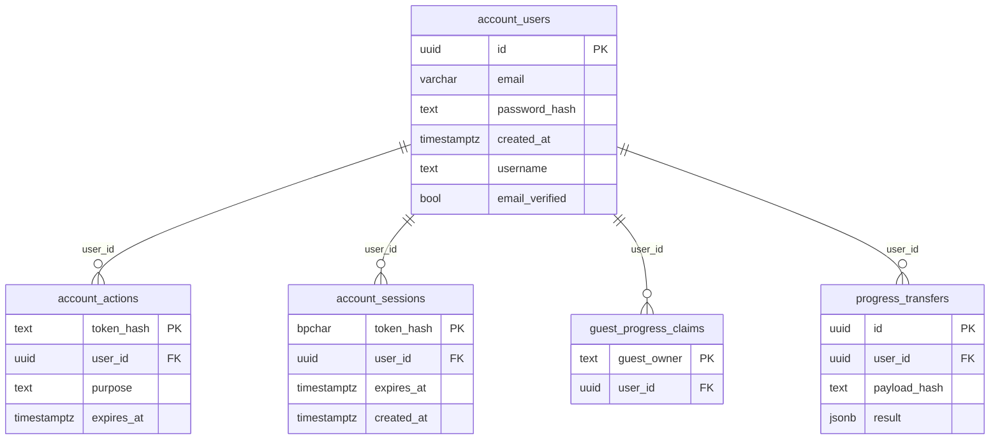

# LexiPlay database diagram

Generated from local PostgreSQL schema metadata on 2026-10-14. Uses physical table and column names. No user records or credentials are included.

## Vocabulary and personal learning

A user has at most one overall My Word List. Official collections are saved as references; saving does not copy words. Selected words can be added to the personal list.

Constraints: unique `user_word_lists.owner_id`; unique dictionary `(normalized_lemma, part_of_speech)`; unique definition `(dictionary_entry_id, language, sense_index)`; unique personal entry `(word_list_id, dictionary_entry_id)`. Collection memberships and saved collections use composite primary keys. `imported_collection_id` is optional (the source collection can be absent). Progress is optional for an entry.

## Existing dictionary and compatibility tables

`dictionary_words.senses` contains English senses as JSONB, not a separate senses table. The application resolves normalized dictionary identities and legacy personal terms against this dictionary; no foreign keys connect those term fields. Existing CEFR game pools remain for compatibility.

## Accounts and sessions

## Operational tables

`word_list_consolidation_backup` holds recovery snapshots of previous lists, words, notes, and progress. `_prisma_migrations` records migration history.

## Definition fallback

Custom definition → approved preferred-language definition → approved English definition → existing English dictionary senses → null. Private edits do not update the shared Dictionary.
