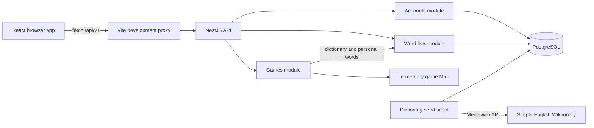

# Learn the LexiPlay codebase

This guide explains the code currently in the repository: which files define each part of the application, how its data is structured, and which technologies it uses. Start here for a code tour, then use [DEVELOPMENT.md](DEVELOPMENT.md) for development conventions.

## 1. The overall structure

LexiPlay is a vocabulary practice application in a **TypeScript monorepo**. A monorepo keeps several related packages in one Git repository. [pnpm-workspace.yaml](../pnpm-workspace.yaml) discovers packages under `apps/*` and `packages/*`; the root [package.json](../package.json) defines commands that run across them.

```text
LexiPlay/
├── apps/
│   ├── web/                 Browser application
│   │   └── src/             React components, styles, cache, and UI tests
│   └── api/                 HTTP server
│       └── src/modules/
│           ├── accounts/    Registration, login, sessions, and account storage
│           ├── games/       Practice games, guesses, scoring, and hints
│           ├── health/      Basic server health endpoint
│           └── word-lists/  Personal vocabulary, dictionary, and file imports
├── packages/shared/        Small shared type definitions and historical word files
├── scripts/dev.mjs         Local development launcher
├── docs/                   Code learning and development documentation
├── outputs/docs/           Product requirements and design documents
├── .github/workflows/      Automated GitHub checks
├── docker-compose.yml      Local PostgreSQL service
├── pnpm-lock.yaml          Locked dependency resolution
└── tsconfig.base.json      Shared TypeScript compiler rules
```

The API is a **modular monolith**: one server composed of feature modules. The browser and server are separate applications communicating through HTTP and JSON.



Vite's proxy is part of local development. The repository does not yet define a production hosting arrangement.

## 2. Technologies and where they are configured

The versions below come from the checked-in manifests, rather than claims about the latest releases.

| Technology | Purpose in LexiPlay | Configuration or example |
| --- | --- | --- |
| Node.js 22+ | Runs development tools, the API, and the seeder. | Root [package.json](../package.json); CI uses Node 22. |
| pnpm 11.25.0 | Installs dependencies and runs workspace scripts. | Root `packageManager`, [pnpm-workspace.yaml](../pnpm-workspace.yaml), and `pnpm-lock.yaml`. |
| TypeScript 5.9.3 | Adds static types to browser and server code. | [tsconfig.base.json](../tsconfig.base.json) enables strict checks; each package extends it. |
| React / React DOM 19.3.0 | Renders browser components and manages UI state with hooks. | [apps/web/package.json](../apps/web/package.json), `main.tsx`, and `App.tsx`. |
| Vite 8.3.0 | Serves the browser app during development and builds production web assets. | [vite.config.ts](../apps/web/vite.config.ts), including the `/api` proxy. |
| CSS and browser APIs | Layout, themes, navigation, storage, and HTTP requests. | `styles.css`, History API, `localStorage`, and `fetch`; navigation is implemented in `App.tsx`. |
| NestJS 11.1.6 with Express | Organizes the API into modules, controllers, and injected services. | [apps/api/package.json](../apps/api/package.json), `main.ts`, and `app.module.ts`. |
| class-validator / class-transformer | Describe DTO input rules and transform nested request objects. | API `*.dto.ts` files and the global `ValidationPipe` in `main.ts`. |
| @nestjs/throttler | Limits requests through guards on account and word-list controllers. | `accounts.module.ts`, `word-lists.module.ts`, and their controllers. |
| PostgreSQL 17 / pg | Persists accounts, sessions, personal lists, and the dictionary using SQL. | [docker-compose.yml](../docker-compose.yml); API repository classes use `pg.Pool`. |
| Node crypto | Password derivation, session-token hashing, UUIDs, and random answer selection. | `account.service.ts` and `game.service.ts`. |
| mammoth / SheetJS xlsx / pdf-parse | Extracts words from DOCX, XLSX, and text-based PDF uploads. | `word-list-import.ts`; TXT and CSV parsing are implemented there directly. |
| tsx | Runs and watches API TypeScript without a separate development compilation step. | API `dev` and `dictionary:seed` scripts. |
| Vitest 5.0.0 | Runs API and browser tests. | Package `test` scripts and colocated `*.test.ts` / `*.test.tsx` files. |
| Testing Library / jsdom | Exercises rendered React components in a simulated browser DOM. | Web test dependencies, `vite.config.ts`, and `test-setup.ts`. |
| Docker Compose / GitHub Actions | Starts local PostgreSQL and runs automated repository checks. | `docker-compose.yml` and [.github/workflows/ci.yml](../.github/workflows/ci.yml). |

The current API uses SQL through `pg`, with no Prisma dependency or Prisma schema. The initial [technical design](../outputs/docs/TECHNICAL_DESIGN.md) proposes Prisma, persisted game history, and other future features; read it as design intent rather than a description of every implemented file.

## 3. Browser code: what each file owns

Paths in this table are relative to `apps/web/`.

| File | Responsibility and useful code to read |
| --- | --- |
| [index.html](../apps/web/index.html) | HTML entry document with the root element and script entry. |
| [src/main.tsx](../apps/web/src/main.tsx) | Finds `#root`, calls React's `createRoot`, renders `App` inside `StrictMode`, and imports styles. |
| [src/App.tsx](../apps/web/src/App.tsx) | Application shell, section navigation, theme, game options, board, keyboard, hints, and game definitions. Read `sectionPaths`, `navigateTo`, `startPractice`, `submitGuess`, and `useHint`. Its local `api<T>` helper makes game and related list requests. |
| [src/AccountPanel.tsx](../apps/web/src/AccountPanel.tsx) | Loads the current account and handles registration, login, logout, and account messages. Makes requests to `/api/v1/auth/*`. |
| [src/WordListsPanel.tsx](../apps/web/src/WordListsPanel.tsx) | Personal list display, search, pagination, manual edits, Known/Unfamiliar toggles, dictionary saves, and upload preview/confirmation. Read `request<T>`, `loadLocalLists`, the pending operation maps, and the route-change effect. |
| [src/dictionary-cache.ts](../apps/web/src/dictionary-cache.ts) | Normalizes dictionary terms, caches search results and canonical definitions, persists them to browser storage, and shares simultaneous requests. Read `searchDictionary`, `dictionaryDefinition`, and `rememberDictionaryDefinition`. |
| [src/styles.css](../apps/web/src/styles.css) | Layout, responsive styling, component appearance, and light/dark theme rules. |
| [src/test-setup.ts](../apps/web/src/test-setup.ts) | Shared browser-test setup. |
| [vite.config.ts](../apps/web/vite.config.ts) | React plugin, local API forwarding, and Vitest's jsdom environment. |

React `useState` holds values that affect rendering, such as the current guess or list contents. `useEffect` coordinates side effects such as loading data and attaching browser events. `useRef` holds mutable values such as input references and pending operations without causing a render by itself.

There is no routing library: `App.tsx` maps paths such as `/play`, `/library`, and `/licenses` to sections, calls `history.pushState`, and listens for `popstate`. Changing sections dispatches `lexiplay:before-route-change`. For signed-in users, `WordListsPanel.tsx` uses that event to flush queued word edits and status changes. Imports use a separate confirmation request. Guest list changes are stored on the device.

The dictionary cache lasts 24 hours and keeps up to 100 searches and 300 definitions. It uses memory if browser storage fails. Personal definitions are separate from cached canonical dictionary definitions.

## 4. API code: modules, controllers, services, repositories, and DTOs

| Layer | What it defines | Example |
| --- | --- | --- |
| Entry point | Server creation and global HTTP configuration. | [main.ts](../apps/api/src/main.ts) sets `/api/v1`, validation, and the loopback listening address. |
| Root module | Which feature modules make up the application. | [app.module.ts](../apps/api/src/app.module.ts) imports Health, Games, Accounts, and WordLists. |
| Feature module | Controllers, providers, imports, and exports for a feature. | [word-lists.module.ts](../apps/api/src/modules/word-lists/word-lists.module.ts) imports Accounts and exports `WordListsService`. |
| Controller | HTTP routes and translation between requests and service calls. | `@Post`, `@Get`, `@Body`, and `@Param` in controller files. |
| Service | Application behavior, rules, and coordination. | `GameService` scores guesses; `WordListsService` checks the current user and normalizes words. |
| Repository | SQL queries and persistence details. | `AccountRepository` and `WordListRepository` own PostgreSQL pools and schema setup. |
| DTO | Expected request fields and validation rules. | `AccountCredentialsDto`, `SaveWordDto`, and `ConfirmWordImportDto`. |

NestJS dependency injection supplies objects to constructors through registered providers and `@Inject`. Feature modules export services when another module needs their behavior: Games imports WordLists, and WordLists imports Accounts.

### Accounts

Files under [apps/api/src/modules/accounts](../apps/api/src/modules/accounts):

- `account.controller.ts` defines `/auth/register`, `/auth/login`, `/auth/logout`, and `/auth/me`, and sets or clears the session cookie.
- `account.service.ts` normalizes emails, derives password hashes with scrypt, verifies passwords, creates 14-day sessions, and hashes session tokens with SHA-256 before storage.
- `account.repository.ts` defines `AccountUser` / `AccountRecord` and queries `account_users` and `account_sessions`.
- `account.dto.ts` defines email validation and a 12–128 character password requirement.
- `session-cookie.ts` extracts and validates the `lexiplay_session` token from the request cookie header.
- `accounts.module.ts` registers providers, exports `AccountService`, and configures account throttling.

The browser receives an HttpOnly, SameSite=Lax cookie scoped to `/api/v1`; `Secure` is added when `NODE_ENV` is `production`. Raw session tokens are not stored in PostgreSQL.

### Games

Files under [apps/api/src/modules/games](../apps/api/src/modules/games):

- `game.controller.ts` defines `POST /games`, `POST /games/:gameId/guesses`, and `POST /games/:gameId/hints`. It obtains personal words when requested and adds dictionary definitions to guess responses.
- `game.service.ts` defines `Game`, `Guess`, `Feedback`, and `WordLength`; owns the game map; selects an answer; checks guesses; scores duplicate letters in two passes; and handles hints and completion.
- `submit-guess.dto.ts` defines the guess request class. See the validation caveat in section 8.
- `games.module.ts` registers the controller and service and imports WordLists.

Games allow six attempts. The service supports word lengths 3–8. `CORRECT` means the right letter in the right position, `PRESENT` means an available matching letter elsewhere, and `ABSENT` means no remaining matching occurrence. Exact matches are counted first so repeated letters are not credited more times than they occur in the answer.

Each game captures its allowed dictionary words at start. Personal-word mode restricts **answers** to saved terms in that dictionary pool; guesses can still use the full pool. Both Known and Unfamiliar personal words are currently eligible. Each game starts with three unused-letter hints and three present-letter hints.

### Personal vocabulary and dictionary

Files under [apps/api/src/modules/word-lists](../apps/api/src/modules/word-lists):

| File | What it defines |
| --- | --- |
| `word-lists.controller.ts` | List retrieval, word create/update/delete, public dictionary search/definition routes, dictionary saves, and multipart import preview/JSON confirmation. |
| `word-lists.service.ts` | Current-user checks, term normalization, duplicate handling, personal game words, dictionary access, and import coordination. |
| `word-list.repository.ts` | `WordEntry`, `WordList`, `DictionaryEntry`, PostgreSQL queries, owner constraints, one-list-per-account setup, and dictionary game-word selection. |
| `word-list.dto.ts` | Manual word, update, dictionary-add, and selected import-row request structures. |
| `word-list-import.ts` | `ImportPreviewRow`, issue codes, file parsers, duplicate detection, and upload/container limits. |
| `seed-simple-wiktionary.ts` | Standalone importer that fetches MediaWiki revisions, stages entries, checks the result, and replaces dictionary rows in a transaction. |
| `wiktionary-definition.ts` | Wikitext-to-plain-text extraction of up to two definition senses and parts of speech. |
| `wiktionary-pagination.ts` | Replaces previous MediaWiki continuation parameters with those from the latest response. |
| `SIMPLE-WIKTIONARY-LICENSE` | Attribution and source license information. |
| `word-lists.module.ts` | Registers the feature's dependencies and exposes `WordListsService` to Games. |

Import preview supports TXT, DOCX, CSV, XLSX, and text-based PDF. Limits include 5 MB per file, 1,000 rows, and the first 50 PDF pages. Preview returns normalized rows, issues, selection flags, and totals; it does not save words. Confirmation writes selected rows, skipping existing terms. Guest preview also calls the API, but guest confirmation stores words locally. See [WORD_LIST_DESIGN.md](../outputs/docs/WORD_LIST_DESIGN.md) for the fuller route and import description.

The dictionary seed fetches data only when explicitly run. Ordinary search and gameplay read PostgreSQL. Its staging transaction preserves the previous dictionary if import fails or required checks fail, including the check for `because`.

## 5. Data structures and where they live

### Persistent data: PostgreSQL

The schema is currently defined inside the repository classes and seeder, not in a standalone migration directory. Account schema creation is lazy on repository access. Word-list schema setup also performs alterations and merges older lists so an owner has one overall list.

| Table | Main fields and relationship | Defining code |
| --- | --- | --- |
| `account_users` | UUID `id`, unique email, password hash, creation timestamp. | `AccountRepository.ensureSchema`. |
| `account_sessions` | Token hash primary key, user ID, expiry and creation timestamps; belongs to an account. | `AccountRepository.ensureSchema`. |
| `user_word_lists` | UUID `id`, owner ID, name, timestamps; unique owner, with the name `My words`. | `WordListRepository.ensureSchema` and `ensureDefaultList`. |
| `user_words` | UUID `id`, list ID, term, definition, optional part of speech, status, timestamps; unique `(list_id, term)`. | `WordListRepository.ensureSchema`. |
| `dictionary_words` | Term primary key, canonical definition, parts-of-speech array. Shared across users. | `WordListRepository.ensureDictionarySchema` and the seed script. |

Personal terms accept letters, spaces, apostrophes, and hyphens, up to 100 characters, and are normalized to lowercase. Definitions are limited to 500 characters in personal entries. `WordStatus` is the union `'KNOWN' | 'UNFAMILIAR'`, with new words defaulting to `UNFAMILIAR`. Game words have narrower requirements: only `a`–`z`, the selected length, and a nonempty canonical definition.

The server's `WordList` response has `{ id, name, words }`; each `WordEntry` has `{ id, term, definition, partOfSpeech, status }`. Repository queries map SQL names such as `part_of_speech` to JSON names such as `partOfSpeech`.

### Transient and browser data

| Location | Structure | Lifetime |
| --- | --- | --- |
| API `GameService.games` | `Map<string, Game>` with an answer, allowed-word `Set`, guesses, hint counts, and revealed-letter sets. | In the API process; lost on restart. |
| React component state | Current section, guess, game response, list contents, messages, and UI controls. | Component/page lifetime. |
| `WordListsPanel` refs | Maps of pending word operations and status changes. | Component lifetime, flushed on the app's route-change event. |
| `localStorage`: `lexiplay-theme` | Light/dark preference. | Across browser reloads on that origin. |
| `localStorage`: `lexiplay-local-word-lists` | Guest personal list and words. | On that browser origin; no implemented account synchronization. |
| `localStorage`: `lexiplay-dictionary-cache-v1` | Cached search/definition entries with `expiresAt`; also held in in-memory maps. | 24-hour cache entries. |

[packages/shared/src/index.ts](../packages/shared/src/index.ts) currently exports only `ApiError` and `HealthStatus` types. Most game/account/list response types are defined locally in the web and API files, rather than imported from a generated shared client. The files in [packages/shared/vocabulary](../packages/shared/vocabulary/README.md) are historical SCOWL word-list snapshots; the current API does not load them for games.

## 6. Trace a feature through the code

### Starting and playing a game

1. `App.startPractice` posts `{ wordLength, playWithMyWords }` to `/api/v1/games`.
2. Vite forwards the request to the local API. `GameController.start` obtains authenticated personal words if that mode is selected.
3. `GameService.start` asks `WordListsService` / `WordListRepository` for valid dictionary terms, chooses an answer, and stores the game in its map. The initial response does not include the answer.
4. `App.submitGuess` posts a guess using the returned game ID. `GameService.submit` validates and scores it and updates completion state.
5. `GameController.submit` adds dictionary definitions; React renders the returned feedback. A completed response also includes the answer and its definition.

### Saving a personal word

1. `WordListsPanel` loads `/word-lists`. The API checks the session and ensures the account's single list exists. A 401 response puts the panel into guest/local mode.
2. Adding or editing a word updates the UI. For a signed-in user, the panel queues that operation in a ref map.
3. An app route change dispatches `lexiplay:before-route-change`; the panel sends queued create/update/delete requests and status changes.
4. `WordListsService` resolves the current account, normalizes the input, and delegates to owner-scoped repository queries. Guest changes instead persist to `localStorage`.

This flow explains why seeing a change in the signed-in list UI does not by itself mean it has already been written to PostgreSQL.

## 7. Run the project and understand the checks

Use Node.js 22+, the pinned pnpm 11.25.0, and Docker for the local database. Run these commands from the repository root:

```powershell
pnpm install
docker compose up -d database
pnpm --filter @lexiplay/api dictionary:seed
pnpm dev
```

The seed command needs internet access and loads or refreshes the local dictionary. [scripts/dev.mjs](../scripts/dev.mjs) starts the API with `PORT=0`, reads its actual address, and passes that address to Vite as `API_ORIGIN`. Both servers use available loopback ports; open the printed web URL. PostgreSQL persists through the named Docker volume.

The code reads environment variables from `process.env`. [.env.example](../.env.example) documents sample settings, but the launcher and API do not currently load `.env` automatically. For custom database settings, set `DATABASE_URL` in the shell before running commands. `WEB_ORIGIN` is a documented placeholder and is not currently consumed by the server; the web app uses relative API requests through the Vite proxy.

```powershell
pnpm test
pnpm typecheck
pnpm build
```

| Check or test file | What it verifies |
| --- | --- |
| `pnpm test` | Runs existing Vitest suites in web and API; shared has no test script. |
| `pnpm typecheck` | Checks each workspace's TypeScript without emitting output. |
| `pnpm build` | Builds shared declarations/JavaScript, API JavaScript, and Vite web assets into package `dist` directories. |
| [App.test.tsx](../apps/web/src/App.test.tsx) | Practice interaction, account UI, navigation, attribution, and play options with mocked API responses. |
| [WordListsPanel.test.tsx](../apps/web/src/WordListsPanel.test.tsx) | Queued changes, dictionary saves, duplicate prevention, guest persistence, pagination, and imports. |
| [dictionary-cache.test.ts](../apps/web/src/dictionary-cache.test.ts) | Shared requests, persistence, expiry, retries, and storage-failure fallback. |
| [health.e2e.test.ts](../apps/api/src/health.e2e.test.ts) | Health HTTP route, dictionary-backed games, personal answer pools, hints, and completion. |
| [accounts.e2e.test.ts](../apps/api/src/modules/accounts/accounts.e2e.test.ts) | Registration, identification, logout, and login through HTTP/session cookies. |
| [word-lists.e2e.test.ts](../apps/api/src/modules/word-lists/word-lists.e2e.test.ts) | Ownership, dictionary access, status changes, and import preview/confirmation through HTTP. |
| `wiktionary-definition.test.ts` / `wiktionary-pagination.test.ts` | Definition extraction and continuation parameter replacement. |

API HTTP tests use deterministic repository substitutes or spies. They do not verify real PostgreSQL schema execution or a live Wiktionary import. Browser tests use jsdom and mocked fetch responses. GitHub [CI](../.github/workflows/ci.yml) installs with the frozen lockfile, then runs tests, typechecking, and builds.

## 8. Current limits to keep in mind while learning

- Active games and guesses are not persisted. There are no implemented game-history/progress tables; Statistics and Community currently render placeholder pages.
- Guest lists remain on the browser origin. Personal-word games require an authenticated API list; they do not read the guest list from browser storage. Changing the local web port also changes the browser storage origin.
- Signed-in manual list edits are queued until app navigation. The current code does not implement a durable pending-operation queue or a page-close save flow.
- `GameService` supports 3–8 letters, but `SubmitGuessDto` still declares `@Length(5, 5)`. The HTTP game tests create the app without the global validation pipe used by `main.ts`; their all-length coverage does not establish that the live validation path accepts every supported length. This is a validation inconsistency in the current code.
- Schema changes currently run inside lazy repository setup. The migration approach described in the development/design docs is a convention to move toward, not a separate implemented migration system.
- PDF import extracts text and does not perform OCR. The health endpoint returns `{ status: 'ok' }` without checking database readiness.

## 9. Suggested reading order

1. Read this guide's structure and technology tables, then the root `package.json` and `scripts/dev.mjs`.
2. Follow `main.tsx` into `App.tsx` and trace a game request into API `main.ts`, `app.module.ts`, `game.controller.ts`, and `game.service.ts`.
3. Read the account controller, service, repository, and cookie helper to understand authentication.
4. Follow `WordListsPanel.tsx` into the word-list controller, service, repository, DTOs, and import parser.
5. Read `dictionary-cache.ts`, the Wiktionary seed helpers, and their tests to understand caching and dictionary ingestion.
6. Use [DEVELOPMENT.md](DEVELOPMENT.md) for conventions, [WORD_LIST_DESIGN.md](../outputs/docs/WORD_LIST_DESIGN.md) for detailed feature behavior, and [dictionary-source-review.md](dictionary-source-review.md) for the recorded dictionary-source decision. Consult [PRD.md](../outputs/docs/PRD.md) and [TECHNICAL_DESIGN.md](../outputs/docs/TECHNICAL_DESIGN.md) for broader product/design intent.
