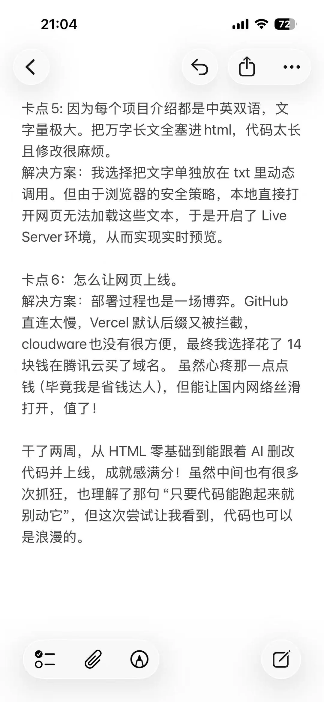
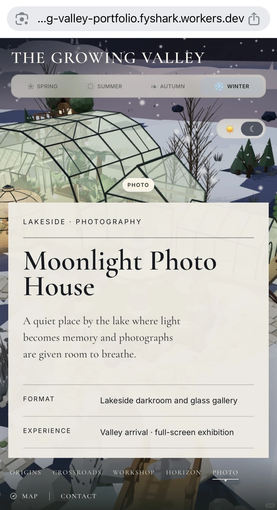

# LexiPlay 小红书推广调研与页面大纲

调研日期：2026-10-18（America/Toronto）。通过用户已登录的小红书浏览器页面查阅。

建议的首发方向：**我把背单词，做成了一个猜词小游戏。**

核心信息顺序：用真实猜词画面吸引注意 → 展示释义与发音 → 收藏到自己的词表 → 用自己的词练习 → 登录保存记录。

## 1. 样本与口径

搜索词：`独立开发 网站`、`vibe coding 作品`、`独立开发 背单词`。优先选择作者展示自己的作品、产品画面清楚、互动较高的笔记；补充教程与开发者访谈，区分它们的用途。

以下是本次搜索样本中的较高互动案例，不是全站榜单。数据取笔记详情页当时可见的点赞 / 收藏 / 评论；平台对万级数据取整，搜索卡片与详情页也有差异，以详情页为准。互动不能证明付费、产品用户数或学习效果。未进行账号体量、发布时间、投流等变量的控制，排版与热度之间不能据此认定因果。

| 类型 | 作者与笔记 | 赞 / 藏 / 评 | 参考价值 |
| --- | --- | --- | --- |
| 作者自有作品 | i=Lili：[纪念我的第一个 Vibe Coding 作品](https://www.xiaohongshu.com/explore/69fb3dae000000003600276f) | 约1万 / 7400 / 230 | 网页成品作封面，白底拼贴、大留白、字体形成个人风格 |
| 作者自有作品 | 雾雨雪：[我把简历做成了3D小岛](https://www.xiaohongshu.com/explore/6abbb0080000000015008fb9) | 3850 / 2209 / 203 | 一个具体的视觉隐喻，直接展示可探索的产品场景 |
| 作者自有作品 | Jade：[分享我的第二个vibe coding作品](https://www.xiaohongshu.com/explore/6a9ca4c7000000000d02708a) | 1112 / 771 / 51 | 七图展示交互花园；前两图以同构图的春冬状态体现变化 |
| 产品制作教程 | 表哥懂设计（AIGC版）：[自制设计师个人网站](https://www.xiaohongshu.com/explore/6aabddb0000000002a005da8) | 4612 / 7046 / 489 | 黑绿高对比、人物、电脑成品和大字标题，面向开发学习者 |
| 产品制作教程 | 小史多喝水：[春天花花收集器](https://www.xiaohongshu.com/explore/69c78b2b000000001f00034c) | 约1.6万 / 约1.6万 / 104 | 生活实拍、手写字幕、一个明确的小作品目标 |
| 学习工具教程 | 喜欢编程的杨同学：[用AI快速刷完一学期单词](https://www.xiaohongshu.com/explore/6960d660000000000e03fbcb) | 约1.2万 / 约2.5万 / 164 | 场景明确、标题结果导向；评论暴露运行和使用门槛 |
| 开发者访谈补充 | 哈哈du（AI版）：[VibeCoding个背单词产品](https://www.xiaohongshu.com/explore/6950b6a1000000002103ff38) | 446 / 450 / 13 | 《词了个词》开发者访谈，观察游戏化词汇产品的表达方式 |

作者自有作品的判断来自作者正文自述。教程不等同产品发布；访谈不是发布者自己的产品。访谈标题中的上线和用户量属于其自述，本次没有后台数据可独立核验。

## 2. 文案与图片提取

仅保留短标题 / 短语、正文结构摘要和参考图片；没有整篇复制。笔记展示的产品没有在本次查阅中获得可直接验证的公开独立站入口，因此以下产品判断来自作者展示画面和介绍，不能当作对这些网站功能的实测结论。Lili 也在评论中说明不公开全部网站内容。

### A. 个人作品集：让成品先说话

- 文案线索：作者从拥有自己的网页切入，再讲遇到的问题和解决过程。
- 画面：纵向网页截图，上部用照片和小插画拼贴，下部放大英文排字；背景白，留白多，产品本身承担封面的视觉信息。
- 正文结构：完成作品的感受 → 工具组合 → 若干具体卡点与解决方法。
- 可借鉴：LexiPlay 封面先放可辨认的彩色猜词格，让用户一眼知道是什么。
- 不照搬：拼贴装饰、求职作品集叙事和开发过程长文，与英语练习的使用场景不同。

参考原图：[本地文件](../marketing/xiaohongshu-reference/lili-portfolio-cover.webp)。来源为上表 Lili 笔记第1张，仅供内部分析。

### B. 3D 小岛：把抽象需求变成具体对象

- 短语线索：“我把简历做成了3D小岛”。
- 画面：大片蓝色海面中放置一座完整小岛，建筑和道路承担导航隐喻，画面比功能文字更突出。
- 正文结构：原始需求 → 为什么选这个形式 → 制作方式。
- 可借鉴：用“我把背单词做成了猜词小游戏”说明改造了什么，比罗列技术栈更直观。
- 产品边界：它展示个人经历空间，不能据此推导适合 LexiPlay 增加 3D 场景。

### C. 交互花园：用不同状态证明可以交互

- 短语线索：“精神世界”。
- 画面：低多边形植物园、柔和绿调、顶部季节按钮、建筑入口标签。第1张春景，第2张冬景，构图一致，变化一目了然。
- 正文结构：动机 → 产品形态 → 当前完成范围 → 过程 → 后续完善。
- 可借鉴：LexiPlay 用“正在猜 → 完成并出现释义 → 收藏后的词表”展示状态变化；不重复展示几张几乎相同的首页。
- 作者明确提到仍有 placeholder；不能将这类精美画面等同完整产品。

参考原图：[本地文件](../marketing/xiaohongshu-reference/jade-garden-cover.webp)。来源为上表 Jade 笔记第1张，仅供内部分析。

### D. 三类补充样本的取舍

- 设计师网站教程：大字、人物和屏幕构成三级视觉层次。适合开发教程受众；LexiPlay 面向英语练习者，首发不应让开发工具名称占据主标题。
- 花花收集器教程：生活实拍使作品与日常场景相连。可借鉴“一次只说一个小目标”，不需要把产品包装成庞大的学习系统。
- 单词工具教程：具体结果容易理解，但评论中有人困惑如何运行、手机能否使用，也有人质疑刷完能否记住。LexiPlay 应明确浏览器入口、展示真实玩法，并将“认识 / 练习单词”和“记住 / 提分”区分开。
- 《词了个词》访谈：产品画面、采访画面与大字成绩信息叠放。可借鉴真实的开发者故事；不要替 LexiPlay 填入未经验证的用户数或留存成绩。

## 3. LexiPlay 的推广定位

**一句话：先猜一局，再认识几个词。**

产品解释：LexiPlay 是一个在浏览器里玩的英语猜词工具。根据颜色提示找答案，查看猜过的词和答案的英文释义，听发音，把想学的词加入个人词表，也能用个人词表继续练习。

首发主要面向喜欢猜词、希望轻量练习英语的人；这是根据功能提出的定位假设，不是已经验证的用户画像。

产品事实来源与功能边界见 [产品核验笔记](lexiplay-promotion-product-facts.md)。

## 4. 小红书首发：8页图文大纲

建议按 1080×1440、3:4 制作，这是本项目的设计建议，不是本次核验的平台强制尺寸。全套保持同一套字级、外边距和产品配色；一页一个动作，一个主标题，最多两行补充。

| 页 | 目的 | 原创主标题 | 画面与补充文案 |
| --- | --- | --- | --- |
| 1 | 停留与识别 | **我把背单词，做成了猜词小游戏** | 猜到一半的真实棋盘占画面主体。小字仅放 `LexiPlay · 浏览器就能玩`；品牌不抢过玩法 |
| 2 | 看懂玩法 | **顺着颜色，一步步猜出答案** | 裁切棋盘和键盘，用三个短标签解释位置正确 / 位置不对 / 不在词中，不放大段规则 |
| 3 | 看见学习价值 | **猜完，不止知道答案** | 同一局结束页，放大英文释义与发音按钮；补充“看看意思，也听听怎么读” |
| 4 | 留下感兴趣的词 | **遇到想学的词，就收起来** | 上半部展示选词按钮，下半部展示保存后的个人词表；只强调一个收藏动作 |
| 5 | 展示差异点 | **下一局，换成你想练的词** | 游戏设置选择个人词表，搭配自己的词表截图；不要暗示所有任意词都能进入所有长度的游戏 |
| 6 | 降低选择压力 | **从适合自己的难度开始** | 长度、难度、词库控件的局部特写；补充“选字母数、难度和词库” |
| 7 | 保存练习记录 | **把每次练习留下来** | 用真实账户数据展示最近记录、胜率、连续练习天数；补充“登录后保存游戏记录”，不伪造漂亮成绩 |
| 8 | 让人行动 | **打开浏览器，先猜一局** | 产品名、清晰可读的访问地址 `lexiplay.onrender.com`、一小块手机端真实画面；收尾提问“试完告诉我：哪一步还可以更顺手？” |

### 视觉方向

- 用 LexiPlay 现有浅色背景、绿色强调色和彩色字母格建立识别；猜词格是主视觉，避免引入无关 3D 吉祥物。
- 产品截图每页突出一个区域，文字放在截图外；保留足够完整的上下文，让人知道按钮属于哪一步。
- 封面主标题分两至三行，产品画面建议占约六成；这是制作起点，最后按实际画面调整。
- 对比状态采用相同尺寸和裁切位置，如“选中 → 已保存”，借鉴花园案例的状态切换表达。
- 参考原图单独保留作内部分析。正式发布的全部宣传图使用自己的真实截图和原创排版。

### 可选标题

1. 我把背单词，做成了猜词小游戏
2. 喜欢 Wordle？试试猜完还能收单词的这一版
3. 做了个英语小网站，想请你来猜一局

推荐第1个；第2个适合已经熟悉 Wordle 的人，第3个更突出个人开发者身份。

### 原创正文草稿

做了一个叫 LexiPlay 的英语猜词小网站。

玩法很直接：输入一个词，跟着颜色提示，一步步找出答案。

我还想把“猜完之后”这一步做好：猜过的词可以看英文释义、听发音，碰到想学的就加入自己的词表；下一局，也可以选个人词表来练习。

字母数、难度和词库都能自己选。打开浏览器就能开始，想把游戏记录留下来，再登录保存。

这次想请大家来试试，也帮我看看：玩法容易理解吗？释义和词表用起来顺不顺手？

LexiPlay：lexiplay.onrender.com

话题建议：`#独立开发` `#英语学习` `#猜单词` `#Wordle` `#网页小游戏`。若制作开发过程内容，再单独使用 `#VibeCoding`；不用技术话题替代产品解释。

## 5. 官网推广落地页大纲

这是一份内容结构，不是本次直接修改产品首页的实现方案。

| 顺序 | 主标题 / 核心文案 | 配图 | 行动 |
| --- | --- | --- | --- |
| 首屏 | **先猜一局，再认识几个词。** / 跟着颜色找答案，把想学的词留在自己的词表里 | 正在进行的真实猜词棋盘；桌面和手机只选一个主画面 | 主按钮“开始猜词”，次入口“看看怎么玩” |
| 玩法 | **输入、看颜色，再试一次** | 同一局的三步局部状态图 | 锚点或轻量演示；无需额外表单 |
| 学习价值 | **猜完，也把意思弄明白** | 英文释义、发音、收藏的真实区域 | “看一个示例” |
| 个人练习 | **把想学的词，变成下一局** | 词表与游戏设置的对应截图 | “探索词库”或“打开我的词表”，按真实登录状态处理 |
| 进度 | **练过的，留下记录** | 真实最近练习记录；无数据时使用诚实的空状态 | “登录保存记录” |
| 收尾 | **下一局，就从这里开始** | 简洁字母格点缀 | “开始猜词”；短问答说明浏览器访问、游客与登录保存、当前玩法范围 |

不增加虚构用户评价、用户量、学习效果数字或未上线功能。第一轮不把技术栈、账户设置、收入故事放在主卖点区域。

## 6. 拍摄与制作清单

1. 真实进行中的一局，反馈格和已输入词清楚可见。
2. 同一局完成后的释义、发音与收藏区域。
3. 收藏后实际进入个人词表的画面。
4. 在游戏中选择个人词表的设置画面；先确认该词表有符合字母数的可用词。
5. 系统词库、字母长度和难度选择的局部画面。
6. 有真实游戏记录的进度页，隐藏邮箱等不必要的个人信息。
7. 手机宽度下的真实游戏界面，检查文字和键盘是否清楚。
8. 入口地址与游客提示，避免写成“游客永久保存全部记录”。

本次交付是调研与页面大纲。参考图片已经提取；LexiPlay 正式宣传图、演示视频与发布尚未制作或执行。

## 7. 下一轮验证

先用两种原创封面比较理解度：A“背单词 → 猜词小游戏”，B“真实棋盘 + 先猜一局”。保持正文和发布条件尽量一致，观察实际曝光下的点击、收藏、有效访问和开始游戏；未接入统计前不假设转化率。小样本结果只用于改下一版，不当作稳定增长结论。
